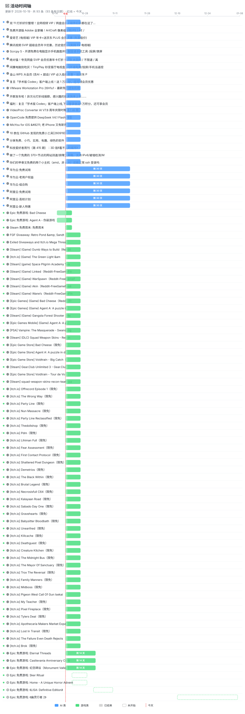

# 🐑 薅羊毛情报站

> 全网 **AI / 游戏** 免费福利活动自动收集 · 每日由 GitHub Actions + AI 更新

---

## 🔗 社区整理的免费资源

> 社区维护的免费资源聚合项目，按方向分类，可作为日常薅羊毛的补充信息源。

### AI / LLM 免费 API

| 项目 | 简介 |
|------|------|
| [AIPMAndy/FreeToken](https://github.com/AIPMAndy/FreeToken) | 收集各类免费 AI API Token 获取方法 |
| [mnfst/awesome-free-llm-apis](https://github.com/mnfst/awesome-free-llm-apis) ⭐10.6k | 永久免费 LLM API 列表 |
| [open-free-llm-api/awesome-freellm-apis](https://github.com/open-free-llm-api/awesome-freellm-apis) ⭐4.4k | 134+ 免费 LLM API & AI API Key，40+ 厂商 |
| [guihuashaoxiang/FreeLLM-API-KeyHub](https://github.com/guihuashaoxiang/FreeLLM-API-KeyHub) | 🇨🇳 国内免费大语言模型 API 资源与接入指南 |

### 云服务 / SaaS 免费层

| 项目 | 简介 |
|------|------|
| [ripienaar/free-for-dev](https://github.com/ripienaar/free-for-dev) ⭐139.8k | SaaS/PaaS/IaaS 免费层列表 |
| [255kb/stack-on-a-budget](https://github.com/255kb/stack-on-a-budget) ⭐12.5k | 对开发者预算友好的免费层服务集合 |

### 开发者创业信用额度

| 项目 | 简介 |
|------|------|
| [dakshshah96/awesome-startup-credits](https://github.com/dakshshah96/awesome-startup-credits) ⭐3k | 创业公司免费/折扣计划合集 |
| [t3-sh/cloudcredits.io](https://github.com/t3-sh/cloudcredits.io) | 云/SaaS/工具的免费信用额度与折扣列表 |

### 游戏免费聚合

| 项目 | 简介 |
|------|------|
| [eikowagenknecht/lootscraper](https://github.com/eikowagenknecht/lootscraper) ⭐320 | 免费 game/loot offers 的 RSS feeds（Steam/Epic/GOG/itchio） |
| [DoSpamu/free-games-claimer](https://github.com/DoSpamu/free-games-claimer) | 自动领取 Epic/Prime/GOG/Steam 免费游戏 |

### 自托管开源软件

| 项目 | 简介 |
|------|------|
| [awesome-selfhosted/awesome-selfhosted](https://github.com/awesome-selfhosted/awesome-selfhosted) ⭐328k | 可自托管的免费网络服务与 Web 应用列表 |

### ChatGPT API 工具

| 项目 | 简介 |
|------|------|
| [reorx/awesome-chatgpt-api](https://github.com/reorx/awesome-chatgpt-api) ⭐6.4k | 使用 ChatGPT API 的应用与工具合集 |

---

## 📅 活动时间轴



> 每条横条 = 一个活动的持续时间 ｜ 红色虚线 = 今天 ｜ 白色进度填充 = 当前完成度
> ｜ 半透明 = 已结束 ｜ 虚线边框 = 未开始 ｜ 🟢进行中 🟡未开始 ⚫已结束

---

## 📊 今日概况

- 更新时间：**2026-10-21 14:07** 北京时间
- 进行中：**120** 个 ｜ 即将开始：**4** 个 ｜ 历史收录：**124** 个

---

## 🗂 分类活动

### 🆓 纯免费（86 条，活跃 82）

> 完全免费、0 元可领取的项目

#### 🔓 开源免费工具（13 条）

| 状态 | 活动 | 福利 | 时间 | 剩余 | 领取 |
|------|------|------|------|------|------|
| 🟢 | 免费开源版 Adobe 全家桶！ArtCraft 像素级复刻 PS / AE / PR / AI 等软件 | — | 长期免费 | — | [领取](https://www.iplaysoft.com/artcraft.html) |
| 🟢 | Scrcpy 5 - 开源免费在电脑显示手机画面并控制安卓手机工具 (投屏/录屏/镜像/免Root) | — | 长期免费 | — | [领取](https://www.iplaysoft.com/scrcpy.html) |
| 🟢 | 闲置电脑别吃灰！TinyPlay 秒变客厅电视盒子 (开源免费/投屏/手机当遥控器) | — | 长期免费 | — | [领取](https://www.iplaysoft.com/tinyplay.html) |
| 🟢 | MicYou for iOS &#8211; 老 iPhone 又有新用途：变成电脑麦克风，免费开源 | — | 长期免费 | — | [领取](https://www.appinn.com/micyou-for-ios/) |
| 🟢 | 10 款在 GitHub 发现的免费小工具[260919] | — | 长期免费 | — | [领取](https://www.appinn.com/10-useful-github-tools-26919/) |
| 🟢 | Konode - 开源浏览器同步工具！跨 Chrome/Edge/Firefox 同步书签/标签页/历史 | — | 长期免费 | — | [领取](https://www.iplaysoft.com/konode.html) |
| 🟢 | reinstall：操作系统自己重装自己？这个开源项目有点神奇 | — | 长期免费 | — | [领取](https://www.appinn.com/bin456789-reinstall/) |
| 🟢 | 比 Finder 快 17000 倍？开源 macOS 全盘文件搜索工具：FSearch | — | 长期免费 | — | [领取](https://www.appinn.com/fsearch-for-macos/) |
| 🟢 | CCleaner 之后，有人重新做了一款开源清理工具：FluentCleaner | — | 长期免费 | — | [领取](https://www.appinn.com/fluentcleaner/) |
| 🟢 | 10 万 Star 开源项目 Neovim 收到 10 BTC 巨额捐赠，3 年后被网友发现，开发团队可能都不知道 | — | 长期免费 | — | [领取](https://www.appinn.com/neovim-10-btc-donation-2/) |
| 🟢 | 单网页开源，纯离线：汉语拼音注音小工具，包含33.7 万词典 | — | 长期免费 | — | [领取](https://www.appinn.com/chinese-pinyin-annotation-tool/) |
| 🟢 | MicYou for iOS – 老 iPhone 又有新用途：变成电脑麦克风，免费开源 | — | 长期免费 | — | [领取](https://www.appinn.com/micyou-for-ios/) |
| 🟢 | VMware Workstation Pro 26H1u1 - 最新免费虚拟机软件专业版 (中文汉化版 / 免激活) | — | 长期免费 | — | [领取](https://www.iplaysoft.com/vmware-workstation.html) |

#### 🎮 游戏喜加一（70 条）

| 状态 | 活动 | 福利 | 时间 | 剩余 | 领取 |
|------|------|------|------|------|------|
| 🟢 | Epic 免费游戏: Bad Cheese ｜坏奶酪 | — | 2026-10-15 ~ 2026-10-22 | — | [领取](https://store.epicgames.com/zh-CN/free-games) |
| 🟢 | Epic 免费游戏: Agent A - 伪装游戏 ｜特工A-伪装游戏 | — | 2026-10-15 ~ 2026-10-22 | — | [领取](https://store.epicgames.com/zh-CN/free-games) |
| 🟢 | Steam 免费周末: 免费周末 | — | 2026-10-19 ~ 2026-10-22 | — | — |
| 🟢 | FGF Giveaway: Retro Pond &amp; Sandtrix+!（Reddit-FreeGameFindings） ｜复古池塘 | — | 2026-10-19 ~ 2026-10-26 | — | [领取](https://www.reddit.com/r/FreeGameFindings/comments/1x7louh/fgf_giveaway_retro_pond_sandtrix/) |
| 🟢 | Exiled Giveaways and Itch.io Mega Threads（Reddit-FreeGameFindings） ｜流放赠品与itch.io大合集 | — | 2026-10-19 ~ 2026-10-26 | — | [领取](https://www.reddit.com/r/FreeGameFindings/comments/1x47cvi/exiled_giveaways_and_itchio_mega_threads/) |
| 🟢 | [Steam] (Game) Dumb Ways to Build（Reddit-FreeGameFindings） ｜蠢蛋建造法 | — | 2026-10-19 ~ 2026-10-26 | — | [领取](https://www.reddit.com/r/FreeGameFindings/comments/1x98rdb/steam_game_dumb_ways_to_build/) |
| 🟢 | [itch.io] (Game) The Green Light &amp; The Black Within（Reddit-FreeGameFindings） ｜绿光与黑境 | — | 2026-10-19 ~ 2026-10-26 | — | [领取](https://www.reddit.com/r/FreeGameFindings/comments/1x8juzt/itchio_game_the_green_light_the_black_within/) |
| 🟢 | [Steam] (game) Space Pilgrim Academy Year 1（Reddit-FreeGameFindings） ｜太空朝圣者学院第一年 | — | 2026-10-19 ~ 2026-10-26 | — | [领取](https://www.reddit.com/r/FreeGameFindings/comments/1x89vdw/steam_game_space_pilgrim_academy_year_1/) |
| 🟢 | [Steam] (Game) Linked（Reddit-FreeGameFindings） ｜链接 | — | 2026-10-19 ~ 2026-10-26 | — | [领取](https://www.reddit.com/r/FreeGameFindings/comments/1x9bvk0/steam_game_linked/) |
| 🟢 | [Steam] (Game) WarSpawn（Reddit-FreeGameFindings） ｜战争重生 | — | 2026-10-19 ~ 2026-10-26 | — | [领取](https://www.reddit.com/r/FreeGameFindings/comments/1x7q1hy/steam_game_warspawn/) |
| 🟢 | [Steam] (Game) Akin（Reddit-FreeGameFindings） ｜相似 | — | 2026-10-19 ~ 2026-10-26 | — | [领取](https://www.reddit.com/r/FreeGameFindings/comments/1x9757j/steam_game_akin/) |
| 🟢 | [Steam] (Game) Wane’s（Reddit-FreeGameFindings） ｜衰退 | — | 2026-10-19 ~ 2026-10-26 | — | [领取](https://www.reddit.com/r/FreeGameFindings/comments/1x7ej2d/steam_game_wanes/) |
| 🟢 | [Epic Games] (Game) Bad Cheese（Reddit-FreeGameFindings） ｜坏奶酪 | — | 2026-10-19 ~ 2026-10-26 | — | [领取](https://www.reddit.com/r/FreeGameFindings/comments/1x6nyl9/epic_games_game_bad_cheese/) |
| 🟢 | [Epic Games] (Game) Agent A: A puzzle in disguise（Reddit-FreeGameFindings） ｜特工A：伪装之谜 | — | 2026-10-19 ~ 2026-10-26 | — | [领取](https://www.reddit.com/r/FreeGameFindings/comments/1x6nylb/epic_games_game_agent_a_a_puzzle_in_disguise/) |
| 🟢 | [Steam] (Game) Gangsta Forest Shooter（Reddit-FreeGameFindings） ｜黑帮森林射手 | — | 2026-10-19 ~ 2026-10-26 | — | [领取](https://www.reddit.com/r/FreeGameFindings/comments/1x8i155/steam_game_gangsta_forest_shooter/) |
| 🟢 | [Epic Games Mobile] (Game) Agent A: A puzzle in disguise（Reddit-FreeGameFindings） ｜特工A：伪装之谜 | — | 2026-10-19 ~ 2026-10-26 | — | [领取](https://www.reddit.com/r/FreeGameFindings/comments/1x6nzqb/epic_games_mobile_game_agent_a_a_puzzle_in/) |
| 🟢 | [PSA] Vampire: The Masquerade - Swansong (EGS), Caravan SandWitch (Amazon Games) are complimentary with Amazon Prime（Reddit-FreeGameFindings） ｜吸血鬼：避世潜藏-天鹅之歌 | — | 2026-10-19 ~ 2026-10-26 | — | [领取](https://www.reddit.com/r/FreeGameFindings/comments/1x6r5x4/psa_vampire_the_masquerade_swansong_egs_caravan/) |
| 🟢 | [Steam] (DLC) Squad Weapon Skins - Recon Team Pack（Reddit-FreeGameFindings） ｜小队武器皮肤-侦察队包 | — | 2026-10-19 ~ 2026-10-26 | — | [领取](https://www.reddit.com/r/FreeGameFindings/comments/1x6ssud/steam_dlc_squad_weapon_skins_recon_team_pack/) |
| 🟢 | [Epic Game Store] Bad Cheese（限免） ｜坏奶酪 | — | 2026-10-19 ~ 2026-10-26 | — | [领取](https://isthereanydeal.com/game/bad-cheese/info/) |
| 🟢 | [Epic Game Store] Agent A: A puzzle in disguise（限免） ｜特工A：伪装之谜 | — | 2026-10-19 ~ 2026-10-26 | — | [领取](https://isthereanydeal.com/game/agent-a-a-puzzle-in-disguise/info/) |
| 🟢 | [Epic Game Store] Voidtrain - Big Catch（限免） ｜虚空列车-大捕获 | — | 2026-10-19 ~ 2026-10-26 | — | [领取](https://isthereanydeal.com/game/voidtrain-big-catch/info/) |
| 🟢 | [Steam] Gear.Club Unlimited 3 - Gear.Club Signature Pack（限免） ｜齿轮俱乐部无限3-签名包 | — | 2026-10-19 ~ 2026-10-26 | — | [领取](https://isthereanydeal.com/game/gear-club-unlimited-3-gear-club-signature-pack/info/) |
| 🟢 | [Epic Game Store] Voidtrain - Tour de Void（限免） ｜虚空列车-虚空之旅 | — | 2026-10-19 ~ 2026-10-26 | — | [领取](https://isthereanydeal.com/game/voidtrain-tour-de-void/info/) |
| 🟢 | [Steam] squad-weapon-skins-recon-team-pack（限免） ｜小队武器皮肤-侦察队包 | — | 2026-10-19 ~ 2026-10-26 | — | [领取](https://isthereanydeal.com/game/squad-weapon-skins-recon-team-pack/info/) |
| 🟢 | [itch.io] Offrecord Episode 1（限免） ｜非官方记录第一章 | — | 2026-10-19 ~ 2026-10-26 | — | [领取](https://redcap-games.itch.io/offrecord-episode-1) |
| 🟢 | [itch.io] The Wrong Way（限免） ｜逆行 | — | 2026-10-19 ~ 2026-10-26 | — | [领取](https://zestosyt.itch.io/the-wrong-way) |
| 🟢 | [itch.io] Party Line（限免） ｜电话分机 | — | 2026-10-19 ~ 2026-10-26 | — | [领取](https://notsospecialgames.itch.io/party-line) |
| 🟢 | [itch.io] Nun Massacre（限免） ｜修女大屠杀 | — | 2026-10-19 ~ 2026-10-26 | — | [领取](https://puppetcombo.itch.io/nun-massacre) |
| 🟢 | [itch.io] Party Line Reclassified（限免） ｜电话分机 | — | 2026-10-19 ~ 2026-10-26 | — | [领取](https://notsospecialgames.itch.io/party-line-reclassified) |
| 🟢 | [itch.io] Thedollshop（限免） ｜玩偶店 | — | 2026-10-19 ~ 2026-10-26 | — | [领取](https://ateliersento.itch.io/thedollshop) |
| 🟢 | [itch.io] Pdm（限免） ｜Pdm | — | 2026-10-19 ~ 2026-10-26 | — | [领取](https://puppetcombo.itch.io/pdm) |
| 🟢 | [itch.io] Lihiman Full（限免） ｜利希曼完整版 | — | 2026-10-19 ~ 2026-10-26 | — | [领取](https://kiwidreams-01.itch.io/lihiman-full) |
| 🟢 | [itch.io] Fear Assessment（限免） ｜恐惧评估 | — | 2026-10-19 ~ 2026-10-26 | — | [领取](https://alexander-wiseman.itch.io/fear-assessment) |
| 🟢 | [itch.io] First Contact Protocol（限免） ｜第一次接触协议 | — | 2026-10-19 ~ 2026-10-26 | — | [领取](https://benjelter.itch.io/first-contact-protocol) |
| 🟢 | [itch.io] Shattered Pixel Dungeon（限免） ｜破碎像素地牢 | — | 2026-10-19 ~ 2026-10-26 | — | [领取](https://shattered-pixel.itch.io/shattered-pixel-dungeon) |
| 🟢 | [itch.io] Demetrios（限免） ｜德米特里奥斯 | — | 2026-10-19 ~ 2026-10-26 | — | [领取](https://cowcat.itch.io/demetrios) |
| 🟢 | [itch.io] The Black Within（限免） ｜黑境 | — | 2026-10-19 ~ 2026-10-26 | — | [领取](https://waleedzo.itch.io/the-black-within) |
| 🟢 | [itch.io] Brutal Legend（限免） ｜横暴传奇 | — | 2026-10-19 ~ 2026-10-26 | — | [领取](https://doublefine.itch.io/brutal-legend) |
| 🟢 | [itch.io] Necrosisfull C64（限免） ｜坏死完整版C64 | — | 2026-10-19 ~ 2026-10-26 | — | [领取](https://mjnurney.itch.io/necrosisfull-c64) |
| 🟢 | [itch.io] Kalayaan Road（限免） ｜卡拉亚安之路 | — | 2026-10-19 ~ 2026-10-26 | — | [领取](https://lawdgames.itch.io/kalayaan-road) |
| 🟢 | [itch.io] Sabado Day One（限免） ｜萨巴多第一天 | — | 2026-10-19 ~ 2026-10-26 | — | [领取](https://kiwidreams-01.itch.io/sabado-day-one) |
| 🟢 | [itch.io] Gravehearts（限免） ｜坟心 | — | 2026-10-19 ~ 2026-10-26 | — | [领取](https://kroovv.itch.io/gravehearts) |
| 🟢 | [itch.io] Babysitter Bloodbath（限免） ｜保姆血浴 | — | 2026-10-19 ~ 2026-10-26 | — | [领取](https://puppetcombo.itch.io/babysitter-bloodbath) |
| 🟢 | [itch.io] Unearthed（限免） ｜出土 | — | 2026-10-19 ~ 2026-10-26 | — | [领取](https://benjelter.itch.io/unearthed) |
| 🟢 | [itch.io] Killcache（限免） ｜杀戮缓存 | — | 2026-10-19 ~ 2026-10-26 | — | [领取](https://verybadscavr.itch.io/killcache) |
| 🟢 | [itch.io] Deathguest（限免） ｜死亡之客 | — | 2026-10-19 ~ 2026-10-26 | — | [领取](https://honeybunny-of.itch.io/deathguest) |
| 🟢 | [itch.io] Creature Kitchen（限免） ｜生物厨房 | — | 2026-10-19 ~ 2026-10-26 | — | [领取](https://the-rat-zone.itch.io/creature-kitchen) |
| 🟢 | [itch.io] The Midnight Bus（限免） ｜午夜巴士 | — | 2026-10-19 ~ 2026-10-26 | — | [领取](https://itandfeel.itch.io/the-midnight-bus) |
| 🟢 | [itch.io] The Mayor Of Sanctuary（限免） ｜避难所市长 | — | 2026-10-19 ~ 2026-10-26 | — | [领取](https://naramakesgames.itch.io/the-mayor-of-sanctuary) |
| 🟢 | [itch.io] Trox The Reversal（限免） ｜特罗克斯逆转 | — | 2026-10-19 ~ 2026-10-26 | — | [领取](https://troj4nblazing.itch.io/trox-the-reversal) |
| 🟢 | [itch.io] Family Manners（限免） ｜家族规矩 | — | 2026-10-19 ~ 2026-10-26 | — | [领取](https://nney.itch.io/family-manners) |
| 🟢 | [itch.io] Midboss（限免） ｜中层Boss | — | 2026-10-19 ~ 2026-10-26 | — | [领取](https://eniko.itch.io/midboss) |
| 🟢 | [itch.io] Pigeon West Call Of Gun Isekai（限免） ｜鸽子西部枪之召唤异世界 | — | 2026-10-19 ~ 2026-10-26 | — | [领取](https://squidsquadpapi.itch.io/pigeon-west-call-of-gun-isekai) |
| 🟢 | [itch.io] My Teacher（限免） ｜我的老师 | — | 2026-10-19 ~ 2026-10-26 | — | [领取](https://w3stgta.itch.io/my-teacher) |
| 🟢 | [itch.io] Pixel Fireplace（限免） ｜像素壁炉 | — | 2026-10-19 ~ 2026-10-26 | — | [领取](https://hammertail.itch.io/pixel-fireplace) |
| 🟢 | [itch.io] Tylers Deal（限免） ｜泰勒的交易 | — | 2026-10-19 ~ 2026-10-26 | — | [领取](https://chodex-productions.itch.io/tylers-deal) |
| 🟢 | [itch.io] Apothecaria Makers Market Expansion（限免） ｜药剂师制造市场扩展 | — | 2026-10-19 ~ 2026-10-26 | — | [领取](https://blackwellwriter.itch.io/apothecaria-makers-market-expansion) |
| 🟢 | [itch.io] Lost In Transit（限免） ｜运输遗失 | — | 2026-10-19 ~ 2026-10-26 | — | [领取](https://boxer-gaming.itch.io/lost-in-transit) |
| 🟢 | [itch.io] The Failure Even Death Rejects（限免） ｜连死亡都拒绝的失败 | — | 2026-10-19 ~ 2026-10-26 | — | [领取](https://bigdeal.itch.io/the-failure-even-death-rejects) |
| 🟢 | [itch.io] Brok（限免） ｜布罗克 | — | 2026-10-19 ~ 2026-10-26 | — | [领取](https://cowcat.itch.io/brok) |
| 🟢 | FGF Giveaway: Retro Pond & Sandtrix+!（Reddit-FreeGameFindings） ｜复古池塘 | — | 2026-10-19 ~ 2026-10-26 | — | [领取](https://www.reddit.com/r/FreeGameFindings/comments/1x7louh/fgf_giveaway_retro_pond_sandtrix/) |
| 🟢 | [itch.io] (Game) The Green Light & The Black Within（Reddit-FreeGameFindings） ｜绿光与黑境 | — | 2026-10-19 ~ 2026-10-26 | — | [领取](https://www.reddit.com/r/FreeGameFindings/comments/1x8juzt/itchio_game_the_green_light_the_black_within/) |
| 🟢 | [itch.io] Rubys Trick Or Treat（限免） ｜露比的不给糖就捣蛋 | — | 2026-10-19 ~ 2026-10-26 | — | [领取](https://kripkode.itch.io/rubys-trick-or-treat) |
| 🟢 | Epic 免费游戏: Eternal Threads ｜永恒之线 | — | 2026-10-19 ~ 2026-11-02 | — | [领取](https://store.epicgames.com/zh-CN/free-games) |
| 🟢 | Epic 免费游戏: Castlevania Anniversary Collection ｜恶魔城周年纪念合集 | — | 2026-10-19 ~ 2026-11-02 | — | [领取](https://store.epicgames.com/zh-CN/free-games) |
| 🟢 | Epic 免费游戏: 纪念碑谷（Monument Valley） ｜纪念碑谷 | — | 2026-10-19 ~ 2026-11-02 | — | [领取](https://store.epicgames.com/zh-CN/free-games) |
| 🟡 | Epic 免费游戏: Sker Ritual ｜斯克尔仪式 | — | 2026-10-22 ~ 2026-10-29 | — | [领取](https://store.epicgames.com/zh-CN/free-games) |
| 🟡 | Epic 免费游戏: Home - A Unique Horror Adventure ｜归家-独特恐怖冒险 | — | 2026-10-22 ~ 2026-10-29 | — | [领取](https://store.epicgames.com/zh-CN/free-games) |
| 🟡 | Epic 免费游戏: 《LISA: Definitive Edition》 ｜LISA：决定版 | — | 2026-11-01 ~ 2026-11-10 | — | [领取](https://store.epicgames.com/zh-CN/free-games) |
| 🟡 | Epic 免费游戏: 《幽灵行者 2》 | — | 2026-12-10 ~ 2027-01-07 | — | [领取](https://store.epicgames.com/zh-CN/free-games) |

#### 🚗 开车线报（3 条）

**AI 车**

| 状态 | 活动 | 福利 | 时间 | 剩余 | 领取 |
|------|------|------|------|------|------|
| 🟢 | [福利] 中转站 Midalo 米搭： Claude/GPT/Gemini 全系 57+ 模型一站接入，新用户注册进群即送 2$ | — | 2026-10-19 ~ 2026-10-26 | — | [领取](https://www.v2ex.com/t/1250070) |

**会员车**

| 状态 | 活动 | 福利 | 时间 | 剩余 | 领取 |
|------|------|------|------|------|------|
| 🟢 | 「Myna 鸣意」发布啦！赠送 Pro 会员兑换码！ | — | 2026-10-19 ~ 2026-10-26 | — | [领取](https://www.v2ex.com/t/1249937) |

**其他车**

| 状态 | 活动 | 福利 | 时间 | 剩余 | 领取 |
|------|------|------|------|------|------|
| 🟢 | 自建反代还是用现成中转？免费领 10 美元算笔账 | — | 2026-10-19 ~ 2026-10-26 | — | [领取](https://www.v2ex.com/t/1249943) |


### 💰 打折优惠（38 条，活跃 38）

> 有折扣但仍需付费的项目

#### 🤖 AI / 云服务优惠（30 条）

| 状态 | 活动 | 福利 | 时间 | 剩余 | 领取 |
|------|------|------|------|------|------|
| 🟢 | OpenCode 免费提供 DeepSeek V4.1 Flash 模型 | — | 2026-10-19 ~ 2026-10-26 | — | [领取](https://www.appinn.com/opencode-free-deepseek-v4-1-flash/) |
| 🟢 | 金山 WPS 大会员 (含AI + 超会) VIP 必入低价优惠 - 送京东 PLUS / 喜马 / 网易云 | — | 2026-10-19 ~ 2026-10-26 | — | [领取](https://www.iplaysoft.com/p/wps-vip) |
| 🟢 | 复旦「学术版 Codex」客户端上线！送 1 万积分，还可领会员优惠 | — | 2026-10-19 ~ 2026-10-26 | — | [领取](https://www.iplaysoft.com/p/qiewenpaper-codex) |
| 🟢 | VideoProc Converter AI V7.8 周年庆限时赠送！AI 视频增强、图片修复与 4K/10K 放大工具免费领 | — | 2026-10-19 ~ 2026-10-26 | — | [领取](https://www.appinn.com/videoproc-converter-ai-v7-8/) |
| 🟢 | 华为云·免费试用 | — | 2026-10-19 ~ 2026-11-18 | — | [领取](https://activity.huaweicloud.com/free_test/index.html) |
| 🟢 | 阿里云·免费试用 | — | 2026-10-19 ~ 2026-11-18 | — | [领取](https://free.aliyun.com) |
| 🟢 | 华为云·老用户权益 | — | 2026-10-19 ~ 2026-11-18 | — | [领取](https://activity.huaweicloud.com/member.html) |
| 🟢 | 华为云·组合购 | — | 2026-10-19 ~ 2026-11-18 | — | [领取](https://activity.huaweicloud.com/group-purchase/index.html) |
| 🟢 | 阿里云·高校计划 | — | 2026-10-19 ~ 2026-11-18 | — | [领取](https://university.aliyun.com) |
| 🟢 | 阿里云·新人特惠 | — | 2026-10-19 ~ 2026-11-18 | — | [领取](https://www.aliyun.com/activity/new) |
| 🟢 | 腾讯·WorkBuddy AI办公 | 免费版 | 2026-10-19 ~ 2026-11-18 | — | [领取](https://workbuddy.tencent.com/) |
| 🟢 | 腾讯云·大促代金券 | — | 2026-10-19 ~ 2026-11-18 | — | [领取](https://cloud.tencent.com/act/new) |
| 🟢 | 腾讯云·校园计划 | — | 2026-10-19 ~ 2026-11-18 | — | [领取](https://cloud.tencent.com/act/campus) |
| 🟢 | 腾讯云·免费体验 | — | 2026-10-19 ~ 2026-11-18 | — | [领取](https://cloud.tencent.com/act/free) |
| 🟢 | 腾讯云·开发者 | — | 2026-10-19 ~ 2026-11-18 | — | [领取](https://cloud.tencent.com/act/developer) |
| 🟢 | 阿里百炼·通义千问新用户免费额度 | 新用户免费 token 额度，含 qwen3.8-max/plus/flash 全系列 | 2026-10-19 ~ 2026-12-31 | — | [领取](https://bailian.console.aliyun.com/) |
| 🟢 | DeepSeek·新用户赠送余额+低价API | 新用户赠送余额，deepseek-flash 空闲时段 input 1元/百万tokens | 2026-10-19 ~ 2026-12-31 | — | [领取](https://platform.deepseek.com/) |
| 🟢 | 腾讯混元·新用户免费额度 | 新用户免费 token 额度，混元大模型全系列 | 2026-10-19 ~ 2026-12-31 | — | [领取](https://cloud.tencent.com/product/hunyuan) |
| 🟢 | 百度千帆·文心新用户免费额度 | 新用户免费额度，ERNIE-Speed 免费 | 2026-10-19 ~ 2026-12-31 | — | [领取](https://qianfan.cloud.baidu.com/) |
| 🟢 | 讯飞星火·免费调用次数 | 新用户免费调用次数，星火 V4.0 等 | 2026-10-19 ~ 2026-12-31 | — | [领取](https://xinghuo.xfyun.cn/) |
| 🟢 | MiniMax·新用户赠送额度 | 新用户赠送额度，M3.1-Flash input 1元/百万tokens | 2026-10-19 ~ 2026-12-31 | — | [领取](https://platform.minimaxi.com/) |
| 🟢 | 360智脑·免费额度 | 新用户免费额度，360智脑大模型 | 2026-10-19 ~ 2026-12-31 | — | [领取](https://ai.360.cn/) |
| 🟢 | 月之暗面Kimi·新用户免费额度 | 新用户免费 token 额度，Kimi K3 长上下文 | 2026-10-19 ~ 2026-12-31 | — | [领取](https://platform.moonshot.cn/) |
| 🟢 | 华为云CodeArts·免费试用 | 新用户免费试用，CodeArts 码道代码智能体 | 2026-10-19 ~ 2026-12-31 | — | [领取](https://www.huaweicloud.com/product/codearts.html) |
| 🟢 | 智谱BigModel·GLM-4-Flash永久免费 | GLM-4-Flash 永久免费，GLM-4 有免费额度 | 2026-10-19 ~ 2027-12-31 | — | [领取](https://open.bigmodel.cn/) |
| 🟢 | 字节扣子Coze·免费搭建智能体 | 免费低代码 Agent 搭建平台，发布智能体不收费 | 2026-10-19 ~ 2027-12-31 | — | [领取](https://www.coze.cn/) |
| 🟢 | Google Gemini·免费版 | Gemini 免费版可用，API 有免费 tier（15 RPM） | 2026-10-19 ~ 2027-12-31 | — | [领取](https://gemini.google.com/) |
| 🟢 | OpenAI ChatGPT·免费版 | ChatGPT 免费版可用 GPTs，API 新用户有免费额度 | 2026-10-19 ~ 2027-12-31 | — | [领取](https://chat.openai.com/) |
| 🟢 | Cursor·免费tier（代码Agent） | 免费版：2000 次补全 + 50 次高级请求/月 | 2026-10-19 ~ 2027-12-31 | — | [领取](https://cursor.com/) |
| 🟢 | 腾讯WorkBuddy·免费使用 | 全场景办公 Agent 工作台，免费使用 | 2026-10-19 ~ 2027-12-31 | — | [领取](https://workbuddy.tencent.com/) |

#### 🛒 购物优惠（2 条）

| 状态 | 活动 | 福利 | 时间 | 剩余 | 领取 |
|------|------|------|------|------|------|
| 🟢 | 双 11 打折好价整理！全网视频 VIP / 网盘会员 / 软件打折都在这了… | — | 2026-10-19 ~ 2026-10-26 | — | [领取](https://www.iplaysoft.com/1111.html) |
| 🟢 | 首发！双 11 红包开领啦~ 积少成多！每天3次 / 可当现金 | — | 2026-10-19 ~ 2026-10-26 | — | [领取](https://www.iplaysoft.com/news/3252) |

#### 📺 视频会员（2 条）

| 状态 | 活动 | 福利 | 时间 | 剩余 | 领取 |
|------|------|------|------|------|------|
| 🟢 | 爱奇艺 (电视端) VIP 年卡+送京东 PLUS 会员优惠 (年度低价) | — | 2026-10-19 ~ 2026-10-26 | — | [领取](https://www.iplaysoft.com/news/4313) |
| 🟢 | 腾讯视频 SVIP 超级会员年卡优惠，历史低价！(支持 TV 电视端) | — | 2026-10-19 ~ 2026-10-26 | — | [领取](https://www.iplaysoft.com/p/txsp-vip) |

#### 💾 网盘会员（2 条）

| 状态 | 活动 | 福利 | 时间 | 剩余 | 领取 |
|------|------|------|------|------|------|
| 🟢 | 绝对值！夸克网盘 SVIP 会员优惠年卡打折！6TB 大空间 / 不限速 / 离线下载 | — | 2026-10-19 ~ 2026-10-26 | — | [领取](https://www.iplaysoft.com/p/quark-svip) |
| 🟢 | 百度网盘 SVIP 超级会员年卡历史低价 (送 B 站会员联名) | — | 2026-10-19 ~ 2026-10-26 | — | [领取](https://www.iplaysoft.com/p/baiduwangpan-svip) |

#### 🏷️ 游戏打折（2 条）

| 状态 | 活动 | 福利 | 时间 | 剩余 | 领取 |
|------|------|------|------|------|------|
| 🟢 | 【10.20】Steam新品节打折：153款佳作最低3元 ｜小黑盒整理 | 40款新史低+86款史低+27款一折以下，最低3元 | 2026-10-20 ~ 2026-10-27 | — | [领取](https://api.xiaoheihe.cn/v3/bbs/app/api/web/share?h_camp=link&h_src=YXBwX3NoYXJl&link_id=1aa472ac9a13) |
| 🟢 | 【10.20】Steam骨折价：169款佳作最低3元 ｜小黑盒整理 | 169款佳作骨折价，最低3元，含新史低与史低 | 2026-10-20 ~ 2026-10-27 | — | [领取](https://xiaoheihe.cn/app/bbs/link/194463102) |


## 🛠 好用 Agent 工具（网页 + 自带 Key + 沙箱）

> AI 编程 Agent 工具推荐，均支持自带 OpenAI 兼容 API Key（BYOK）。不进日历，长期可用。

### 最贴合需求（网页 + 自带 Key + 运行沙箱 + Agent）

| 工具 | 特点 | 自带 Key | 地址 |
|------|------|---------|------|
| **bolt.diy** | 开源，浏览器内 WebContainer 沙箱，agent 写码直接运行/预览 | ✅ 任意 OpenAI 兼容 API | https://bolt.diy |
| **bolt.new** | StackBlitz 官方版，同上 | ✅ | https://bolt.new |
| **OpenCode web** | `opencode web` 起网页版，沙箱=本机环境 | ✅ ChatAnywhere provider | 本地起 |
| **OpenHands** | 开源自部署，Docker 沙箱，agent 自主写码/跑命令/改文件 | ✅ 任意 key | 自部署 |

### 其他可选

| 工具 | 特点 | 自带 Key | 地址 |
|------|------|---------|------|
| Replit | 网页 IDE + Replit Agent，沙箱完整 | ❌ 平台额度 | https://replit.com |
| CodeSandbox | 网页沙箱 + AI | 部分 | https://codesandbox.io |
| Dify | 网页 agent 平台，偏 workflow，有代码执行节点 | ✅ 国内可用 | https://dify.ai |
| Coze（扣子） | 同上，字节出品 | ✅ 国内可用 | https://coze.cn |
| LobeChat | 网页聊天 + 工具/插件，代码沙箱弱 | ✅ | https://lobechat.com |
| Open WebUI | 网页聊天 + 工具/插件 | ✅ | 自部署 |

### 选择建议

- **想零部署直接试** → bolt.diy，填 ChatAnywhere 的 baseURL + key 即开即用
- **想长期自己搭类码道环境** → OpenCode web 或 OpenHands 自部署

---

## 🚀 快速开始（2 步跑通）

### 第 1 步：配置 AI API Key Secret

workflow 已默认配置 ChatAnywhere 中转站 + `deepseek-v3-2` 弱模型（在 `.github/workflows/daily-collect.yml` 的 env 里），**只需配 1 个 Secret**：

进入仓库 **Settings → Secrets and variables → Actions → New repository secret**：
- Name：`AI_API_KEY`
- Value：你的 ChatAnywhere API Key（形如 `sk-xxxxxxxx`，去 [chatanywhere](https://chatanywhere.top) 注册免费领取）

> ChatAnywhere 免费版：每周 50000 点 + 每天 100 次请求，用 `deepseek-v3-2` 弱模型省额度，每次跑约调 AI 30-50 次基本够。

**想换其他中转站？** 编辑 workflow 的 env 改 `AI_BASE_URL` / `AI_MODEL`（任意 OpenAI 协议兼容的都行）：

| 中转站 | `AI_BASE_URL` | `AI_MODEL` | 说明 |
|--------|---------------|------------|------|
| ChatAnywhere（默认） | `https://api.chatanywhere.org/v1` | `deepseek-v3-2` | 免费版每周 50000 点 |
| DeepSeek 官方 | `https://api.deepseek.com/v1` | `deepseek-chat` | 便宜、中文好、有 function calling |
| 智谱 BigModel | `https://open.bigmodel.cn/api/paas/v4` | `glm-4-flash` | 免费额度大 |
| 通义千问 | `https://dashscope.aliyuncs.com/compatible-mode/v1` | `qwen-turbo` | 阿里云百炼 |

> 框架不绑定具体厂商，任意 OpenAI 协议兼容的中转站都能用。

### 第 2 步：手动触发首次运行

进入 **Actions → Daily Collect → Run workflow** → 等绿勾出现（约 2-5 分钟）

完成后：
- 本 README 顶部的 **活动时间轴** SVG 会自动更新（你正在看的就是）
- 下方分类表格会列出所有活动
- `data/{ai,games}/activities.json` 是结构化原始数据

之后每天分 **6 个时段** 自动运行（分散全天、避开整点，减轻免费源网站压力），无需干预：

| 北京时间 | 模式 | 做什么 |
|---------|------|-------|
| 06:17 | `ai-cloud` | 云厂商活动（华为云/阿里云/腾讯云） |
| 09:23 | `ai-blog` | 博客聚合（AI 板块，含开源工具分流） |
| 11:41 | `drive` | V2EX 开车线报 |
| 14:37 | `games-direct` | Epic/Steam/GOG 官方 API |
| 16:53 | `games-blog` | ITAD/itch.io/Reddit/ggdeals |
| 20:47 | `finalize` | 整理：生成 SVG 日历 + 前端 JSON + README |

> ℹ️ 本仓库**不依赖 GitHub Pages**，日历直接以 SVG 图片形式嵌在 README 里渲染，任何账号都能用。

---

## 🍴 Fork 后如何使用（完整指南）

本仓库完全 fork 友好，fork 后按以下步骤配置即可独立运行，**不需要修改任何代码**。

### 1. Fork 仓库

点击本仓库右上角 **Fork** 按钮，复制到你自己的账号下。

### 2. 启用 Actions（关键，fork 后默认禁用）

进入你 fork 后的仓库 → **Actions** 标签页 → 会看到提示 "Workflows aren't being run on this forked repository" → 点击 **"I understand my workflows, enable them"** 按钮。

> ⚠️ 不启用这一步，定时任务永远不会跑。

### 3. 配置 AI_API_KEY Secret

进入你 fork 仓库的 **Settings → Secrets and variables → Actions → New repository secret**，添加：
- Name：`AI_API_KEY`
- Value：你的 ChatAnywhere API Key（去 [chatanywhere](https://chatanywhere.top) 注册免费领）

> fork 的仓库 secrets 不会从上游继承，必须自己配。workflow 的 `AI_BASE_URL` / `AI_MODEL` 已默认配好 ChatAnywhere + `deepseek-v3-2`，想换其他中转站再改 workflow env。

### 4. （可选）调整定时时间

fork 后 workflow 的 cron 默认和上游一样（6 个时段分散全天，避开整点）。建议把每个 cron 的分钟数整体加一个偏移量（如 +5），避免和上游同时跑：

编辑 `.github/workflows/daily-collect.yml`，6 个 cron 表达式形如 `17 22 * * *`（= UTC 22:17 = 北京 06:17）。北京时间 = UTC + 8。改分钟数即可错峰，如 `22 22 * * *`（延后 5 分钟）。

### 5. 手动触发首次运行

**Actions → Daily Collect → Run workflow** → 等绿勾。

### 6. 查看结果

运行成功后，直接看你 fork 仓库的 **README.md**——顶部的活动时间轴 SVG 和分类表格都会自动更新。不需要任何额外部署。

### 7. （可选）同步上游更新

上游有更新时，在你 fork 仓库首页会显示 **"Sync fork"** 按钮，点击即可同步。同步后你的自定义改动（如 `sources.json`、cron 时间）会保留。

### 8. （可选）自定义你的种子源

编辑 `data/sources.json`，加你想监控的网站：
```json
{
  "name": "某个活动页",
  "url": "https://example.com/promo",
  "category": "ai",
  "type": "html",
  "enabled": true,
  "note": "备注"
}
```
`category` 可选 `ai` / `games` / `mixed`。提交后下次运行自动生效。

---

## 🧱 技术框架

| 层 | 技术 | 说明 |
|----|------|------|
| 语言 | Python 3 | 所有收集 / 生成脚本，纯标准库 + `requests` |
| CI/CD | GitHub Actions | 6 时段 cron 定时触发，零服务器，免费额度足够 |
| AI | OpenAI 兼容中转站 | 默认 ChatAnywhere + `deepseek-v3-2` 弱模型，可换 DeepSeek / 智谱 / 通义 |
| 数据存储 | JSON 文件 | `data/*/activities.json`，无数据库，git 即版本控制 |
| 去重 | 稳定 ID（标题+URL 哈希） | 旧值优先合并，防止覆盖已确认字段 |
| 可视化 | SVG 甘特图 | `docs/calendar.svg`，零前端依赖，README 直接 `` 渲染 |
| 部署 | 零部署 | 不依赖 GitHub Pages / Vercel，README 嵌 SVG 即是展示位 |

**设计理念**：全链路零外部服务依赖（除 AI 中转站外），GitHub 仓库本身即数据库 + CI + 展示位。fork 后配一个 Secret 就能跑。

---

## 🔧 工作原理

```
┌─────────────┐   ┌──────────────┐   ┌─────────────┐   ┌──────────────┐
│ 种子源抓取   │ → │  AI 抽取活动  │ → │  去重合并    │ → │  生成产物    │
│ sources.json│   │ (中转站 API) │   │ (稳定 ID)   │   │ SVG+README  │
└─────────────┘   └──────────────┘   └─────────────┘   └──────────────┘
                         ↑
                  ┌──────────────┐
                  │ AI 联网搜索  │  混合模式补充
                  └──────────────┘
                         ↓
          八大分类：ai / shopping / video-vip / netdisk-vip / open-source / drive / games / game-discount
 ```

1. **每日 6 时段定时**：GitHub Actions 分六个时段分散全天运行（避开整点，减轻免费源网站压力），北京时间 06:17 / 09:23 / 11:41 / 14:37 / 16:53 / 20:47，分别跑 `ai-cloud` / `ai-blog` / `drive` / `games-direct` / `games-blog` / `finalize` 六个子模式
2. **种子源抓取**：从 `data/sources.json` 列出的目标网站抓取页面文本（内置 52 个源，全部启用——Action runner 在海外，可访问 Steam/Reddit/HuggingFace/Google AI Studio 等国内墙的网站）
3. **AI 抽取**：用 `scripts/prompts.py` 里写好的教程式提示词，调 OpenAI 兼容中转站，从页面内容里抽取结构化活动信息。**特别关注游戏「喜加一」**（Epic/Steam/GOG 免费游戏，用户最爱）
4. **八大分类分流**：抓到的活动按规则归入 `ai`（云服务/AI 优惠）/ `shopping`（双11/红包等纯购物促销）/ `video-vip`（爱奇艺/腾讯视频会员）/ `netdisk-vip`（夸克/百度网盘会员）/ `open-source`（一直免费的开源工具）/ `drive`（开车线报）/ `games`（游戏喜加一）/ `game-discount`（Steam 打折汇总，小黑盒 SPA + Playwright）八个类别。游戏标题含英文的在末尾附中文翻译（格式 `英文原名 ｜中文译名`）
5. **联网搜索补充**：AI 用预设关键词联网搜索，发现种子源之外的新活动（混合模式）
6. **去重合并**：按稳定 ID（标题 + URL 哈希）去重，已有字段优先保留（旧值优先，防止覆盖已确认数据），按日期重算 status
7. **生成产物**（`finalize` 阶段）：
   - 更新 `data/{ai,shopping,video-vip,netdisk-vip,open-source,drive,games,game-discount}/activities.json`（原始数据）
   - 生成 `docs/calendar.svg`（README 顶部嵌入的甘特图日历，开源工具不进时间轴）
   - 生成 `docs/data/{activities,meta}.json`（结构化数据，可选用于自建前端）
   - 重写 `README.md`（嵌入 SVG + 分类表格）
8. **自动提交**：bot 身份 commit & push 回仓库

---

## 📁 仓库结构

```
wool-gathering/
├── AGENT.md                       # 维护规范（给 AI 或人看的操作交接文档，14 节）
├── .github/workflows/
│   └── daily-collect.yml          # Actions：六时段定时任务 + 自动提交
├── data/                          # 原始数据（脚本写，人别手改）
│   ├── ai/activities.json         # AI/云服务优惠（自动生成）
│   ├── open-source/activities.json# 开源免费工具（长期免费，end_date 空）
│   ├── drive/activities.json      # 开车线报（自动生成）
│   ├── games/activities.json      # 游戏喜加一（自动生成）
│   └── sources.json               # 种子源列表（51 个源，全部启用，可手改）
├── scripts/                       # Python 收集脚本
│   ├── ai_client.py               # AI 中转站客户端（OpenAI 兼容）
│   ├── collect.py                 # 主入口（Action 调用，支持子模式）
│   ├── prompts.py                 # AI 提示词（抽取规则、喜加一识别、字段要求）
│   ├── ai_guide.md                # AI 使用教程（人可读完整文档）
│   ├── cloud_collector.py         # 云厂商抓取（华为云/阿里云/腾讯云/腾讯 WorkBuddy）
│   ├── blog_collector.py          # 博客/V2EX/Reddit/ITAD/itch.io 抓取 + 分类规则
│   ├── direct_collector.py        # Epic/Steam/GOG 官方 API 抓取
│   ├── dedup.py                   # 去重合并 + 状态刷新
│   ├── svg_calendar.py            # SVG 甘特图日历生成（含文字防重叠）
│   ├── calendar_generator.py      # 前端数据 + README 生成（含车型子分类）
│   ├── readme_template.md         # README 模板
│   ├── utils.py                   # 工具函数
│   └── requirements.txt
├── docs/                          # 生成产物目录
│   ├── calendar.svg               # README 嵌入的日历（自动生成）
│   ├── GAME_PLATFORMS.md          # 游戏平台介绍（当前启用 + 可扩展源）
│   └── data/                      # 结构化 JSON（可选用于自建前端）
└── README.md                      # 本文件（由脚本自动刷新）
```

---

## 📊 活动数据结构

每条活动 JSON：

```json
{
  "id": "huaweicloud-ai-200-abc123",
  "title": "华为云 AI 200 代金券",
  "category": "ai",
  "source_url": "https://...",
  "claim_url": "https://...",
  "start_date": "2026-10-18",
  "end_date": "2026-10-25",
  "value": "200 元代金券",
  "requirements": ["实名认证", "新用户"],
  "description": "新用户专享，可叠加免费额度",
  "tags": ["代金券", "华为云", "AI"],
  "discovered_at": "2026-10-18T09:00:00+08:00",
  "last_seen": "2026-10-18",
  "status": "active"
}
```

`status` 由起止日期每天自动重算：`active`（进行中）/ `upcoming`（未开始）/ `ended`（已结束）。

---

## 📅 日历视图说明

README 顶部的 `docs/calendar.svg` 是一个甘特图时间轴：

- **时间轴跨度固定为当月**（刻度只显示当月 1 日到月末）
- 显示所有有截止日期的活动（开源工具无截止日期，不进时间轴）
- 持续时间超过一个月的活动，横条**顶满**当月时间轴显示
- **按分区分组**：AI → 购物 → 视频会员 → 网盘会员 → 开车 → 游戏，每个分区有标题行（带条数）
- 分区内按截止日期**升序**排列（快结束的排上面）
- 每个活动一条**横条**，长度对应活动持续时间（clamp 到当月范围内）
- 横条上的**白色进度填充**表示当前完成度
- **红色虚线**标记"今天"位置
- **半透明**横条 = 已结束
- **虚线边框** = 未开始
- 左侧带状态图标：🟢进行中 🟡未开始 ⚫已结束
- 横条上显示"剩 N 天"
- 底部图例说明各分类颜色含义

这样一眼就能看出哪些活动在并行进行、各自还剩多久，避免好几天都重复关注同一个活动。

---

## 🧠 AI 提示词

收集信息的 AI 提示词写在 `scripts/prompts.py`，明确定义了：

- **什么算薅羊毛活动**（8 类算 / 8 类不算）
- **特别关注游戏喜加一**（Epic/Steam/GOG 免费游戏，含字段填写规范）
- **必须抽取的字段及格式**（title/url/日期/价值/条件等）
- **日期自然语言换算表**（"即日起"→今天、"至月底"→当月最后一天等）
- **边界情况处理**（登录页/错误页/空页面/JS 空壳 → 返回空数组）
- **常见错误及避免方法**（8 条）
- **完整示例**（喜加一/代金券/免费额度）
- **输出格式**（严格 JSON）

完整的人可读教程见 **[scripts/ai_guide.md](scripts/ai_guide.md)**，包含 10 个章节 + 4 个完整示例。

想调整抽取规则（比如放宽/收紧什么算薅羊毛），直接改 `prompts.py` 或 `ai_guide.md` 即可，不用动其他代码。

---

## 🛠 自定义

### 添加种子源

编辑 `data/sources.json`，加一条：

```json
{
  "name": "活动页名称",
  "url": "https://example.com/promo",
  "category": "ai",
  "type": "html",
  "enabled": true,
  "note": "备注"
}
```

字段说明：
- `category`：`ai` / `games` / `mixed`
- `type`：`html` / `rss` / `api` / `manual`
- `enabled`：`false` 可临时禁用

### 调整联网搜索关键词

编辑 `scripts/collect.py` 里的 `SEARCH_KEYWORDS` 字典。

### 调整 AI 抽取规则

编辑 `scripts/prompts.py` 里的 `SYSTEM_PROMPT`。

### 修改运行时间

编辑 `.github/workflows/daily-collect.yml` 的 6 个 cron 表达式（UTC 时间，北京时间 = UTC + 8）：

```yaml
schedule:
  - cron: "17 22 * * *"   # 06:17 北京 → ai-cloud（云厂商）
  - cron: "23 1 * * *"    # 09:23 北京 → ai-blog（博客聚合）
  - cron: "41 3 * * *"    # 11:41 北京 → drive（V2EX 开车线报）
  - cron: "37 6 * * *"    # 14:37 北京 → games-direct（Epic/Steam/GOG）
  - cron: "53 8 * * *"    # 16:53 北京 → games-blog（ITAD/itch.io/Reddit）
  - cron: "47 12 * * *"   # 20:47 北京 → finalize（整理：SVG + README）
```

> 6 个时段分散全天、避开整点，减轻免费源网站压力。改分钟数即可错峰。

---

## 💻 本地调试

```bash
git clone https://github.com/<你的用户名>/wool-gathering.git
cd wool-gathering
pip install -r scripts/requirements.txt

export AI_BASE_URL="https://api.chatanywhere.org/v1"
export AI_API_KEY="sk-xxx"
export AI_MODEL="deepseek-v3-2"
export GITHUB_REPOSITORY="<你的用户名>/wool-gathering"

cd scripts && python collect.py
```

跑完后 `data/`、`docs/calendar.svg`、`README.md` 都会更新。

---

## ❓ 常见问题

**Q: Action 跑了但没收集到任何活动？**
A: 检查 Actions 日志，常见原因：① Secrets 没配或配错；② 中转站不支持联网搜索（不影响种子源抽取，但搜索补充会空）；③ 种子源页面结构变了导致 AI 抽不到——可在 `sources.json` 里换 URL 或暂时 `enabled: false`。

**Q: README 顶部的日历 SVG 不显示？**
A: SVG 是 Action 生成后 commit 进仓库的。确认 Actions 跑成功过一次，且 `docs/calendar.svg` 文件存在。GitHub 渲染 README 里的 SVG 图片有时有几分钟缓存延迟，刷新一下即可。

**Q: fork 后 Actions 不跑？**
A: fork 默认禁用 Actions，需要到 Actions 页点 "I understand my workflows, enable them"。

**Q: 想改成私有仓库？**
A: 可以。本方案不依赖 GitHub Pages，私有仓库也能正常跑 Action + 在 README 渲染 SVG。

**Q: 每天跑会不会消耗很多 AI 额度？**
A: 6 个时段加起来每次约调 AI 30-50 次（51 个种子源抽取 + 联网搜索补充），用 ChatAnywhere 免费版（每周 50000 点 + 每天 100 次请求）或 DeepSeek/智谱免费额度基本够，单次成本约几分钱。

**Q: 想要更炫的可视化页面？**
A: `docs/data/activities.json` 已经生成好了，可以自己写个 HTML 读它部署到任意静态托管（GitHub Pages / Vercel / Cloudflare Pages 都行）。本仓库的 `docs/index.html` 也保留着之前的完整前端，可按需启用。

---

## ⚠️ 免责声明

- 本项目仅**收集公开活动信息**，不参与任何活动分发
- 领取请前往活动官方页面，遵守各平台规则
- AI 抽取的信息可能存在误差，请以活动官方页面为准
- 不对活动的真实性、可用性做任何保证
- 请勿用于商业转售或批量囤积违反平台规则的行为

---

## 📜 License

MIT — 随意 fork、修改、商用，但请保留原作者署名。
